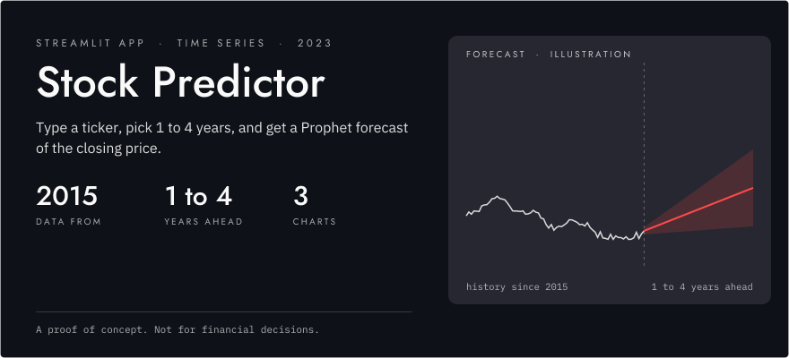
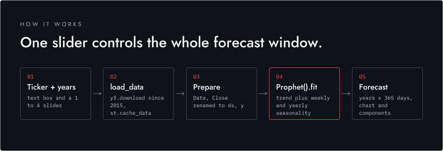
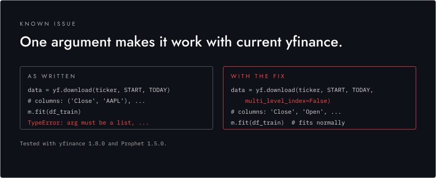

<p align="center">
  <picture>
    <source media="(prefers-color-scheme: dark)" srcset="assets/readme/hero-dark.svg">
    <source media="(prefers-color-scheme: light)" srcset="assets/readme/hero-light.svg">
    
  </picture>
</p>

<p align="center">
  <strong>Type a ticker, pick 1 to 4 years, and get a Prophet forecast of the closing price.</strong><br>
  <sub>Streamlit, yfinance, Prophet and Plotly. A proof of concept: don't use it to make financial decisions.</sub>
</p>

<p align="center">
  
  
  
  
</p>

---

Type a ticker symbol and choose a forecast length of 1 to 4 years. The app pulls daily prices since January 2015 from Yahoo Finance, shows the latest rows and an interactive chart of open and close prices, then fits a Prophet model to the closing prices. It plots the forecast with its uncertainty band, plus Prophet's trend and seasonality components.

## Demo


## How it works

<p align="center">
  <picture>
    <source media="(prefers-color-scheme: dark)" srcset="assets/readme/how-it-works-dark.svg">
    <source media="(prefers-color-scheme: light)" srcset="assets/readme/how-it-works-light.svg">
    
  </picture>
</p>

`load_data` downloads the history with `yf.download` and is wrapped in `st.cache_data`, so moving the slider doesn't download the data again. The app renames `Date` and `Close` to Prophet's expected `ds` and `y` and fits the default model, which handles trend plus weekly and yearly seasonality with no feature engineering. The horizon becomes `years × 365` days and goes to `make_future_dataframe`, so the one slider sets the whole forecast window.

Other details:

- Any ticker Yahoo Finance knows works, typed into a text box.
- The historical chart is an interactive Plotly figure with a range slider.
- The components plot (Matplotlib, from Prophet) shows trend, weekly and yearly seasonality separately.
- An empty input, a ticker with no data, and a failed fit each show a message instead of a stack trace.

| Area | Tools |
|---|---|
| App | Streamlit |
| Data | yfinance, pandas |
| Forecasting | Prophet |
| Charts | Plotly, Matplotlib (Prophet components) |

## Known issue

<p align="center">
  <picture>
    <source media="(prefers-color-scheme: dark)" srcset="assets/readme/known-issue-dark.svg">
    <source media="(prefers-color-scheme: light)" srcset="assets/readme/known-issue-light.svg">
    
  </picture>
</p>

Current versions of `yfinance` return a two-level column index such as `('Close', 'AAPL')`, and `m.fit` then fails with `TypeError: arg must be a list, tuple, 1-d array, or Series`. Older `yfinance` versions no longer download any data from Yahoo, so pinning an old version doesn't help. The fix is one argument in `load_data`:

```python
data = yf.download(ticker, START, TODAY, multi_level_index=False)
```

With that change the app fits and forecasts normally on yfinance 1.8.0 and Prophet 1.5.0.

## Getting started

```sh
pip install streamlit yfinance prophet plotly
streamlit run main.py
```

Then open the local URL Streamlit prints, usually http://localhost:8501.
