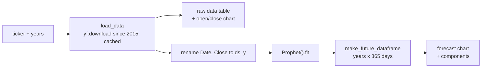

# Stock Predictor

A Streamlit app that downloads a stock's price history from Yahoo Finance and forecasts its closing price up to four years ahead with Prophet.


> This is a proof of concept. Don't use it to make financial decisions.

## Demo


## Overview

Type a ticker symbol and choose a forecast length of 1 to 4 years. The app pulls daily prices since January 2015 with `yfinance`, shows the latest rows and an interactive chart of open and close prices, then fits a Prophet model to the closing prices. It plots the forecast with its uncertainty band, plus Prophet's trend and seasonality components.

## Key features

- Any ticker Yahoo Finance knows, typed into a text box.
- Forecast length from 1 to 4 years, picked with a slider.
- An interactive Plotly chart of historical open and close prices with a range slider.
- A Prophet forecast chart with an uncertainty interval, and a components plot showing trend, weekly and yearly seasonality.
- Messages for an empty input, a ticker with no data, and a failed fit, instead of a stack trace.
- Downloads are cached with `st.cache_data`, so changing the slider doesn't download the data again.

## Tech stack

| Area | Tools |
|---|---|
| App | Streamlit |
| Data | yfinance, pandas |
| Forecasting | Prophet |
| Charts | Plotly, Matplotlib (Prophet components) |

## How it works



## Technical highlights

- Prophet models a time series as trend plus weekly and yearly seasonality, so the app needs no feature engineering. It renames the columns to Prophet's expected `ds` and `y` and uses the default model.
- The forecast horizon is converted to days (`years × 365`) and passed to `make_future_dataframe`, so one slider controls the forecast window.

## Getting started

```sh
pip install streamlit yfinance prophet plotly
streamlit run main.py
```

Then open the local URL Streamlit prints, usually http://localhost:8501.

## Known issue

Current versions of `yfinance` return a two-level column index (`('Close', 'AAPL')`), and `m.fit` then fails with `TypeError: arg must be a list, tuple, 1-d array, or Series`. Older `yfinance` versions no longer download any data from Yahoo. The fix is one argument in `load_data`:

```python
data = yf.download(ticker, START, TODAY, multi_level_index=False)
```

With that change the app fits and forecasts normally on yfinance 1.8.0 and Prophet 1.5.0.
